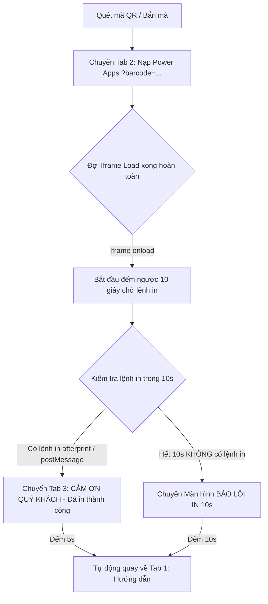

# HTML5 Barcode & QR Kiosk Scanner for Microsoft Power Apps

Hệ thống Kiosk tự động tích hợp quét mã QR/Barcode và điều khiển in ấn qua **Microsoft Power Apps**. Hỗ trợ tùy chọn linh hoạt **Camera quét tự động**, **Máy bắn mã vạch / QR Code cầm tay (USB / Bluetooth)** hoặc **Cả hai song song**, tích hợp quy trình **Chờ Nạp Hoàn Tất & Kiểm Soát Lỗi In 10s**.

---

## 🌟 Tính Năng Nổi Bật (Key Features)

### 1. ⏱️ Quy Trình Chờ Load Hoàn Tất & Kiểm Soát Lệnh In Thông Minh:

- **Bước 1:** Đợi trang Power Apps nạp xong 100% (`iframe.onload`).
- **Bước 2:** Bắt đầu đồng hồ đếm ngược **10 giây (10s delay)**:
  - Nếu trong 10s có lệnh in được gửi (`afterprint` hoặc `postMessage`) ➔ Chuyển ngay sang **Trang Cảm ơn** (phát chuông Chime) ➔ Đếm 5s quay về trang đầu.
  - Nếu hết 10s mà **không nhận được lệnh in** ➔ Chuyển sang **Trang Báo Lỗi** (phát âm cảnh báo, thông báo lỗi `PRINT_TIMEOUT_NOT_DISPATCHED (10s)`) ➔ Hiển thị 10s rồi tự động quay về trang đầu.

---

### 2. 🎯 Tùy Chọn Chế Độ Nạp Mã (Input Mode Selector):
- **`📷 Chỉ Camera`:** Dành cho Kiosk chỉ dùng camera quét tự động.
- **`🔫 Chỉ Máy bắn`:** Tự động tắt luồng Camera (tiết kiệm CPU/RAM), hiển thị giao diện đồ họa súng bắn mã chuyên dụng và phóng to ô nhập mã.
- **`⚡ Cả hai (Dual Mode - Mặc định)`:** Hoạt động song song cả Camera và Súng bắn mã cầm tay.

---

### 3. 🔫 Hỗ Trợ Toàn Diện Máy Bắn Mã QR / Barcode (USB & Bluetooth):
- **Bắt phím toàn cục (Global Key Capture):** Bắt trọn vẹn luồng phím từ súng bắn mã dù người dùng có lỡ click chuột ra ngoài ô nhập liệu.
- **Bộ đệm chờ 1 giây Inactive (Debounce 1000ms):** Đảm bảo máy bắn gửi hoàn tất 100% độ dài chuỗi mã trước khi chuyển tab nạp vào Power Apps.
- **Auto-Refocus:** Tự động bắt lại con trỏ vào ô nhập liệu khi ở Tab 1.

---

### 4. 🎛️ Điều Hướng 3 Tab & Màn Hình Báo Lỗi:
- **`📖 1. Hướng dẫn` (Start):** Màn hình chào mừng và hướng dẫn khách hàng quét mã hoặc bắn mã.
- **`⚡ 2. Đang in (10s)` (Process / Power Apps):** Màn hình nạp app và giám sát in ấn.
- **`🎉 3. Cảm ơn` (Thank You):** Thông báo trạng thái `DISPATCHED_TO_SPOOLER` sau khi in thành công.
- **`⚠️ Màn hình Lỗi` (Error Screen):** Thông báo lỗi khi quá 10 giây không có lệnh in, kèm nút *Thử lại ngay* hoặc *Quay về trang đầu*.

---

## 🚀 Cấu Trúc Tệp Tin (File Structure)

| Tệp tin | Mô tả |
|---|---|
| 🌟 **[`index.html`](file:///e:/Claude/HTML5-Scanner/index.html)** | **Phiên bản Kiosk chính thức:** Tùy chọn Camera/Súng bắn, 3 Tab điều hướng, kiểm soát lệnh in 10s & màn hình báo lỗi, âm thanh Web Audio và in Kiosk. |
| 🌟 **[`kiosk-v3.html`](file:///e:/Claude/HTML5-Scanner/kiosk-v3.html)** | **Phiên bản V3 (HPT D-DAY 2026 Theme):** Áp dụng toàn bộ hệ thống thiết kế từ `layout.html` (Deep Navy, Tech-Cyan, R³ Branding, Live Ticker Bar, Event Stats Box, Laser Reticle, Web Audio). |
| 🌟 **[`kiosk-v2.html`](file:///e:/Claude/HTML5-Scanner/kiosk-v2.html)** | Bản sao Kiosk V2 (Dark Slate Theme). |
| 🎨 **[`layout.html`](file:///e:/Claude/HTML5-Scanner/layout.html)** | Mẫu thiết kế layout sự kiện HPT D-DAY 2026 R³. |
| 📋 **[`TASK.md`](file:///e:/Claude/HTML5-Scanner/TASK.md)** | Báo cáo tiến độ, checklist tính năng và tài liệu kỹ thuật. |
| 📖 **[`README.md`](file:///e:/Claude/HTML5-Scanner/README.md)** | Tài liệu hướng dẫn sử dụng và kiến trúc hệ thống. |

---

## 🛠️ Tùy Chỉnh Cấu Hình (Settings)
Bấm vào nút **`⚙️ Cài đặt`** trên thanh công cụ để điều chỉnh:
- **Thời gian chờ lệnh in sau khi load Power Apps:** Mặc định `10s`.
- **Thời gian hiển thị trang Báo lỗi:** Mặc định `10s`.
- **Chế độ nạp mã mặc định:** `both` (Cả hai) / `camera` (Chỉ Camera) / `gun` (Chỉ Máy bắn).
- **URL Power Apps:** Đường dẫn ứng dụng Canvas App.
- **Thời gian chờ máy bắn mã (ms):** Mặc định `1000ms` (1 giây).
- **Thời gian hiển thị trang Cảm ơn:** Mặc định `5s`.
- **Thời gian tạm dừng camera (Pause):** Mặc định `30s`.
