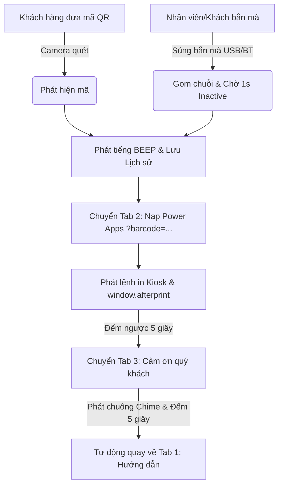

# HTML5 Barcode & QR Kiosk Scanner for Microsoft Power Apps

Hệ thống Kiosk tự động tích hợp quét mã QR/Barcode và điều khiển in ấn qua **Microsoft Power Apps**. Hỗ trợ tùy chọn linh hoạt **Camera quét tự động**, **Máy bắn mã vạch / QR Code cầm tay (USB / Bluetooth)** hoặc **Cả hai song song**.

---

## 🌟 Tính Năng Nổi Bật (Key Features)

### 1. 🎯 Tùy Chọn Chế Độ Nạp Mã (Input Mode Selector):
Cho phép chuyển đổi 1-chạm giữa 3 chế độ hoạt động:
- **`📷 Chỉ Camera`:** Dành cho Kiosk chỉ dùng camera quét tự động.
- **`🔫 Chỉ Máy bắn`:** Tự động tắt luồng Camera (tiết kiệm CPU/RAM), hiển thị giao diện đồ họa súng bắn mã chuyên dụng và phóng to ô nhập mã.
- **`⚡ Cả hai (Dual Mode - Mặc định)`:** Hoạt động song song cả Camera và Súng bắn mã cầm tay.

---

### 2. 🎛️ Điều Hướng 3 Tab Trực Quan (3-Stage Workflow):
Hỗ trợ chuyển đổi linh hoạt cả tự động theo quy trình lẫn chuyển thủ công bằng 3 nút Tab trên thanh tiêu đề:
- **`📖 1. Hướng dẫn` (Start):** Màn hình chào mừng và hướng dẫn khách hàng quét mã hoặc bắn mã.
- **`⚡ 2. Đang in (5s)` (Process / Power Apps):**
  - Khi quét mã tự động: Nạp Power Apps kèm `?barcode=...`, gọi lệnh in Kiosk (`window.print()`) và đếm ngược 5 giây.
  - Khi bấm bằng tay: Giữ nguyên màn hình Power Apps để quản trị viên tự do **đăng nhập tài khoản Microsoft 365**, cấu hình hoặc kiểm tra form.
  - Có nút **`🌐 Mở Tab mới (Đăng nhập MFA)`** để vượt qua cơ chế chặn iframe của trang đăng nhập Microsoft Entra ID.
- **`🎉 3. Cảm ơn (5s)` (Thank You):** Phát chuông Chime chúc mừng, thông báo trạng thái `DISPATCHED_TO_SPOOLER` và đếm ngược 5 giây trước khi tự động quay về Tab 1.

---

### 3. 🔫 Hỗ Trợ Toàn Diện Máy Bắn Mã QR / Barcode (USB & Bluetooth):
- **Bắt phím toàn cục (Global Key Capture):** Bắt trọn vẹn luồng phím từ súng bắn mã dù người dùng có lỡ click chuột ra ngoài ô nhập liệu.
- **Bộ đệm chờ 1 giây Inactive (Debounce 1000ms):** Đảm bảo máy bắn gửi hoàn tất 100% độ dài chuỗi mã trước khi chuyển tab nạp vào Power Apps.
- **Auto-Refocus:** Tự động bắt lại con trỏ vào ô nhập liệu khi ở Tab 1.

---

### 4. 📷 Đa Phương Thức Quét & Tiện Ích Kiosk:
- **Camera Auto Scan:** Tích hợp `html5-qrcode` v2.3.8 với khung ngắm Laser và hiệu ứng Flash.
- **Hỗ trợ chọn Camera & Đèn Flash (Torch):** Chuyển đổi giữa các camera và bật/tắt đèn chiếu sáng.
- **Quét từ File Ảnh:** Hỗ trợ tải ảnh có sẵn để giải mã.
- **Âm thanh tổng hợp (Web Audio API):** Phát tiếng BEEP công nghiệp và chuông Chime chúc mừng không cần nạp file mp3 ngoài.
- **Lịch sử quét (Scan History):** Lưu trữ mã quét cục bộ, tìm kiếm, copy và xuất file **CSV**.
- **Đổi bên (Layout Flip) & Toàn màn hình (Fullscreen Kiosk Mode).**

---

## 🚀 Cấu Trúc Tệp Tin (File Structure)

| Tệp tin | Mô tả |
|---|---|
| 🌟 **[`kiosk-v2.html`](file:///e:/Claude/HTML5-Scanner/kiosk-v2.html)** | **Phiên bản Kiosk hoàn chỉnh (V2):** Tùy chọn Camera/Súng bắn, 3 Tab điều hướng, xác thực Power Apps, âm thanh Web Audio, lịch sử CSV và in Kiosk. |
| 📄 **[`index.html`](file:///e:/Claude/HTML5-Scanner/index.html)** | Phiên bản Kiosk gốc ổn định (Split-screen 70/30). |
| 📋 **[`TASK.md`](file:///e:/Claude/HTML5-Scanner/TASK.md)** | Báo cáo tiến độ, checklist tính năng và tài liệu kỹ thuật. |
| 📖 **[`README.md`](file:///e:/Claude/HTML5-Scanner/README.md)** | Tài liệu hướng dẫn sử dụng và kiến trúc hệ thống. |

---

## 🔄 Luồng Hoạt Động (Architecture Flow)

---

## 🛠️ Tùy Chỉnh Cấu Hình (Settings)
Bấm vào nút **`⚙️ Cài đặt`** trên thanh công cụ để điều chỉnh:
- **Chế độ nạp mã mặc định:** `both` (Cả hai) / `camera` (Chỉ Camera) / `gun` (Chỉ Máy bắn).
- **URL Power Apps:** Đường dẫn ứng dụng Canvas App.
- **Thời gian chờ máy bắn mã (ms):** Mặc định `1000ms` (1 giây).
- **Thời gian hiển thị trang Đang in:** Mặc định `5s`.
- **Thời gian hiển thị trang Cảm ơn:** Mặc định `5s`.
- **Thời gian tạm dừng camera (Pause):** Mặc định `30s`.
- Bật/Tắt âm thanh, rung phản hồi và sao chép Clipboard.
